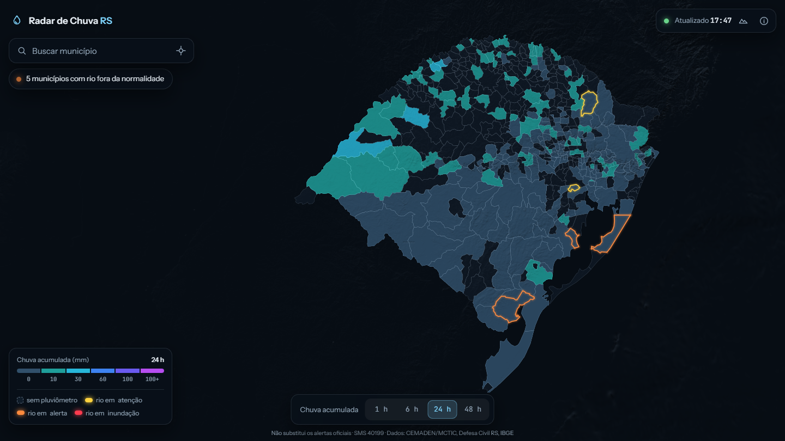
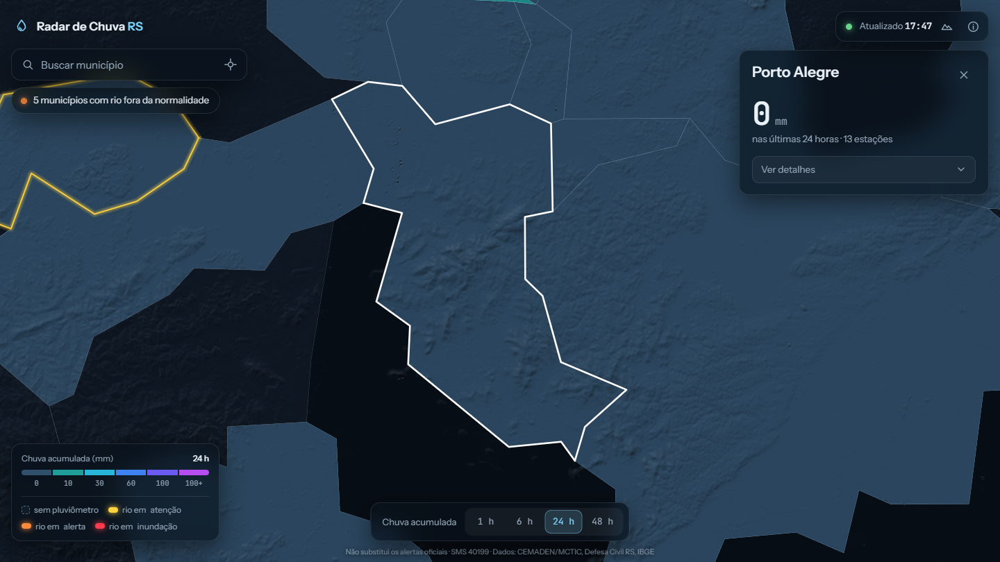
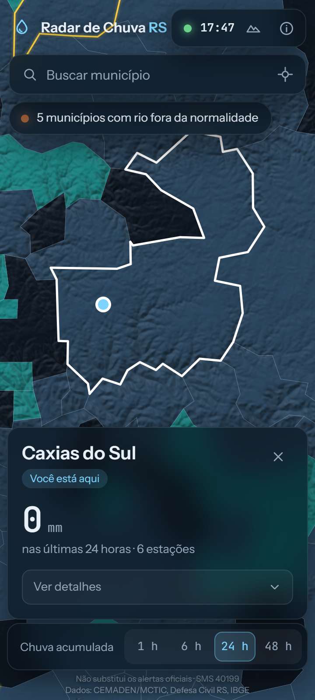

# Radar de Chuva RS

**[Ver ao vivo](https://lukinas1417.github.io/radar-chuva-rs/)**

Mapa web, em tela cheia, da chuva acumulada (1 h, 6 h e 24 h) e da previsão (próximas 6 h e 24 h) em cada município do Rio Grande do Sul, com
a situação dos rios. Os dados vêm quase em tempo real dos pluviômetros do CEMADEN e da Defesa Civil do RS, e uma
estimativa e previsão por modelo (Open-Meteo) cobre os municípios sem pluviômetro. O
contorno dos municípios com rio em atenção, alerta ou inundação pulsa suavemente, e o relevo 3D é opcional.

> Projeto de portfólio. **Não substitui os alertas oficiais da Defesa Civil** (SMS 40199 com o CEP, ou 199).



<p>
  
  
</p>

## Por que existe

Os dados públicos de chuva e de rios do Brasil existem, mas estão espalhados em portais difíceis de ler. A ideia
foi juntar as fontes oficiais em uma única tela que qualquer pessoa entenda de relance: "quanto choveu na minha
cidade e como está o rio?". O mapa mostra também onde **não há** dado, porque a ausência de pluviômetro não
significa ausência de chuva.

## Decisões técnicas

O que o sistema precisa ter para ser confiável, os modos de falha tratados e os limites conhecidos estão em
[docs/arquitetura.md](docs/arquitetura.md). Um resumo:

- **Fontes instáveis são o caso normal.** O endpoint público do CEMADEN recusa conexões de forma intermitente, e o da
  Defesa Civil chegou a ficar com certificado vencido. O workflow tenta de novo, reaproveita o último dado publicado
  se a coleta falhar e o site só avisa em âmbar quando nenhuma fonte de chuva (pluviômetros ou estimativa do modelo) está em dia. Os rios, que não têm substituto, têm aviso próprio.
- **"Sem dado" nunca vira "sem problema".** Estação sem leitura recente é `null`, não zero, e a pílula de rios
  nunca indica normalidade quando não há leitura. A situação do rio é rotulada como informada pela Defesa Civil,
  porque a API não expõe as cotas e a própria documentação é ambígua sobre o que o status representa.
- **Medição, estimativa e previsão nunca se misturam.** Onde há pluviômetro em dia, vale a medição. Onde não há, o
  mapa mostra a estimativa do modelo, e a previsão (+6 h, +24 h) vem sempre dele; as duas levam "~", selo e cor
  transparente, e o cartão avisa que não é medição. Sem previsão o município fica "sem dado", nunca 0 mm. A coleta é
  de 3 em 3 horas para respeitar o limite gratuito da API.
- **Sem build, sem dependências e sem servidor.** O site é estático (MapLibre GL). Um workflow do GitHub Actions
  coleta os dados a cada 15 minutos e publica no Pages, sem gerar commits.
- **Geometria compartilhada.** O mesmo ponto-em-polígono (`src/geo.js`) atribui cada estação ao seu município na
  coleta (Node) e acha a cidade do usuário no navegador.
- **Privacidade.** A localização é usada só no navegador e nunca é enviada nem guardada. As fontes de texto ficam
  no próprio repositório, sem Google Fonts.
- **Acessibilidade.** Busca como combobox com teclado, `aria-*` nos controles e respeito a `prefers-reduced-motion`.

## Interface

- Mapa em tela cheia; tudo o mais flutua sobre ele em painéis de vidro fosco.
- **Sua cidade:** o botão de localização (ou o convite na primeira visita) acha o município e abre o cartão dele.
- **Janela de tempo:** 1 h, 6 h e 24 h mostram o que já choveu; +6 h e +24 h mostram a previsão para o estado todo.
- O cartão abre **compacto** (chuva, previsão das próximas 24 h e situação do rio) e expande para barras, gráfico hora a
  hora da previsão, rios e estações. Em municípios sem pluviômetro, mostra a estimativa do modelo e os vizinhos com medição.
- O link guarda o município e a janela de tempo (`#m=4314902&j=24h`), então dá para compartilhar uma cidade.
- Vista de cima por padrão; o botão de relevo liga a vista 3D.
- **Zoom com limites** (nem tão longe que mostre "dois RS", nem tão perto que mostre as arestas da malha), com um
  controle deslizante e o botão "Ver o RS todo". Recarregar a página não aproxima do município.
- **Notícias** logo abaixo do cartão da cidade (no celular, pela pílula "Notícias"): as recentes que citam o
  município; sem nenhuma, o painel avisa e mostra os destaques do estado. Fontes: G1 RS e Agência Brasil (RSS
  público); só título, fonte e link, e a seleção é automática por palavras-chave.

## Como rodar

Requer Node 22+. Sem dependências.

```sh
node --test   # 83 testes do núcleo (geometria, normalização das fontes, regras de dados e notícias)
```

```sh
node scripts/fetch-municipios.mjs   # malha municipal do IBGE (uma vez)
node scripts/fetch-chuva.mjs        # estações de chuva do CEMADEN (repetir para atualizar)
node scripts/fetch-rios.mjs         # estações de rio e chuva da Defesa Civil RS (opcional)
node scripts/fetch-estimativa.mjs   # estimativa de chuva por modelo, Open-Meteo (opcional; ~20 s)
node scripts/fetch-noticias.mjs     # notícias recentes (opcional)
node scripts/serve.mjs              # http://localhost:8080
```

## Como funciona

- `scripts/fetch-chuva.mjs` consulta o endpoint público do Mapa Interativo do CEMADEN e grava
  `data/chuva-rs.json`. O CEMADEN só preenche o acumulado quando choveu na janela, então `"-"` em estação com
  leitura recente (últimas 3 h) vira **0 mm**, e estação sem leitura recente vira **sem dado**.
- `scripts/fetch-rios.mjs` consulta a [API da Defesa Civil do RS](https://sistemas.defesacivil.rs.gov.br/api-redehidrometeorologica)
  (GraphQL, dados a cada 5 minutos). A API só aceita o texto exato da consulta documentada, guardado em
  `scripts/consultas/tags_data.graphql`. Ela traz o nível dos rios e a chuva dos pluviômetros da Defesa Civil.
- `scripts/fetch-estimativa.mjs` pede ao [Open-Meteo](https://open-meteo.com/) (gratuito para uso não comercial, CC BY 4.0)
  a precipitação horária (últimas 30 h e próximas 36 h) no centro de cada município e grava `data/estimativa-rs.json`. É um modelo, não uma
  medição: o acumulado estimado só aparece onde não há medição em dia, e a previsão (+6 h, +24 h) vem sempre dele; ambos rotulados ("~", "estimado", cor mais transparente). A coleta é de
  3 em 3 h para respeitar o limite de chamadas; nas outras execuções o arquivo publicado é reaproveitado.
- O valor de cada município é o maior acumulado entre as estações ativas dele, das duas fontes.
- O contorno luminoso usa a pior situação de rio informada pela Defesa Civil entre as estações do município.
- O relevo 3D vem dos tiles públicos Terrarium (Mapzen/AWS); as demais camadas são desenhadas a partir da malha do IBGE.

## Cobertura e limitações

- Com as duas fontes ativas: pluviômetros em 222 dos 497 municípios (187 pelo CEMADEN, mais 35 pela Defesa Civil) e
  125 estações de rio. Mais da metade dos municípios não tem pluviômetro nessas redes.
- O endpoint de chuva do CEMADEN não é documentado oficialmente e pode mudar. O oficial (PED) usa token que expira em
  poucas horas e login com captcha, o que impede o uso em coleta agendada.
- A API da Defesa Civil não declara licença de uso; a fonte é citada no site. A atribuição das estações aos
  municípios usa uma malha simplificada, então estações junto a uma divisa podem cair no município vizinho.
- Ainda não há camada de risco de inundação (as cartas do SGB cobrem só 26 municípios gaúchos).

## Fontes

DADOS DA REDE OBSERVACIONAL DO CEMADEN/MCTIC (citação exigida pelas regras de utilização da PED), Rede
Hidrometeorológica da Defesa Civil do RS, malha municipal do IBGE e relevo Terrarium (Mapzen/AWS).

## Autor

Lucas de Mélo Berra, desenvolvedor Full Stack. [Portfólio](https://lukinas1417.github.io/) · [GitHub](https://github.com/lukinas1417).

## Licença

O código é distribuído sob a licença [MIT](LICENSE). Os **dados** não são cobertos por ela: pertencem
ao CEMADEN, à Defesa Civil do RS e ao IBGE, e seguem os termos de cada órgão.
