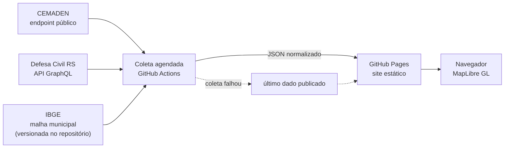

# Arquitetura e decisões

Este documento explica **o que o sistema precisa ter para ser confiável** e por que o Radar de Chuva RS foi
desenhado assim. O código é pequeno; o difícil estava em decidir o que fazer quando o dado falta, chega velho ou é
ambíguo, porque a tela mostra chuva e rios e alguém pode agir com base nela.

## Contexto

O Radar junta duas fontes oficiais, sem acordo formal com nenhuma delas:

- **CEMADEN**: pluviômetros do país. Usa-se o endpoint público do Mapa Interativo, que não é um serviço documentado.
- **Defesa Civil do RS**: API GraphQL com o nível de 125 estações de rio e a chuva de seus pluviômetros.

Mais a malha municipal do IBGE. O resultado é um site estático que mostra, por município, a chuva acumulada e a
situação dos rios.

## Visão geral

A coleta normaliza os dados e publica arquivos JSON ao lado do site. Não há servidor nem banco: o navegador lê os
JSON e desenha o mapa.

## Requisitos que guiaram o desenho

| Requisito | Por quê |
|---|---|
| **Não mentir** | Quem olha o mapa pode tomar uma decisão. Um dado ausente ou velho não pode parecer um dado normal. |
| **Continuar de pé com fontes instáveis** | As duas fontes falharam de verdade durante o desenvolvimento. Falha é o caso normal, não a exceção. |
| **Operação mínima** | Projeto de uma pessoa, sem orçamento: sem servidor para manter, sem custo fixo. |
| **Respeitar as fontes** | Limites de requisição, citação obrigatória e termos de uso diferentes em cada fonte. |
| **Privacidade** | A localização do usuário é sensível e não precisa sair do aparelho. |

## Modos de falha e resposta

| O que falha | Como é tratado | O que o usuário vê |
|---|---|---|
| Endpoint do CEMADEN recusa conexão (observado várias vezes) | 5 tentativas com espera crescente; se todas falharem, reaproveita o último dado publicado | Dado anterior; aviso quando passa de 1 hora |
| API da Defesa Civil fora do ar ou com certificado vencido (observado) | A verificação de TLS **não é desativada**; o dado anterior é mantido | O resumo de rios passa a dizer "Rios de 21/10 17:47: ..." e o status fica âmbar |
| Estação sem leitura recente | Chuva: leitura de mais de 3 h vira `null`. Rios: mais de 30 min antes da coleta é descartada | "Sem dado" ou "sem leitura recente", nunca zero |
| Agendador do GitHub atrasa ou descarta execuções (observado: 4 execuções em ~15 h) | Horários fora dos minutos de pico. **Não resolvido**: precisa de gatilho externo | O dado envelhece e o aviso de 1 hora aparece |
| Significado do `status` de rio é ambíguo na documentação | Rotulado como "situação informada pela Defesa Civil", com nota de que as cotas não são divulgadas | O sistema não afirma o que não sabe |
| API oficial do CEMADEN (PED): token expira em 4 h e o login tem captcha | Testada e descartada para coleta agendada. O captcha **não é contornado** | Nada: continua no endpoint público |
| Estação perto de uma divisa cai no município vizinho (malha simplificada) | Limitação documentada; o painel mostra o nome da estação | O usuário pode conferir |
| Feed de notícias fora do ar | Cada fonte falha sozinha; se nenhuma responde, o último arquivo publicado é reaproveitado. Notícias são opcionais | As últimas notícias, com o horário da coleta (e "Desatualizado" depois de 3 h); sem arquivo, o painel não aparece |
| Notícia fora de contexto passa pelo filtro de palavras-chave (ex.: um texto sobre o "símbolo da enchente") | Só entra o que tem pontuação mínima e menos de 72 h; limitação **não resolvida**, por ser uma heurística | O "Sobre os dados" avisa que a seleção é automática e pode errar |

## Decisões e trade-offs

**Site estático com coleta agendada, em vez de backend.** Custo zero, nada para manter, nenhuma superfície de
ataque no servidor. O preço é a latência (o dado tem alguns minutos) e a dependência do agendador, que se mostrou
o ponto frágil.

**`null` em vez de `0`.** O CEMADEN só preenche o acumulado quando choveu, então `"-"` em uma estação ativa
significa 0 mm, mas em uma estação parada significa que não sabemos. As duas situações têm tratamentos diferentes e
o mapa mostra onde **não há** pluviômetro, em vez de pintar tudo de "sem chuva".

**"Recente" medido contra o momento da coleta, não contra o relógio.** Esta decisão veio de um erro real: a
primeira versão comparava a idade da leitura com a hora atual. Quando a coleta de rios parou, todas as estações
passaram a ser descartadas como "sem leitura", e o painel passou a dizer "Nenhum rio fora da normalidade" com um
ponto verde, enquanto 5 municípios estavam em atenção ou alerta. O defeito só apareceu no site publicado, não no
teste local. A regra que ficou: **um estado desconhecido nunca vira um estado normal**.

**Maior acumulado entre as estações do município.** Regra simples e conservadora: não subestima. O custo é
poder superestimar localmente se uma estação estiver muito perto de um ponto de chuva forte.

**Consulta GraphQL fixa e versionada.** A API da Defesa Civil só aceita o texto exato da consulta documentada, então
ela fica em um arquivo (`scripts/consultas/tags_data.graphql`) e não é montada em código.

**Geometria compartilhada.** O ponto-em-polígono é o mesmo no script de coleta (para atribuir estações a
municípios) e no navegador (para achar a cidade do usuário), em um único módulo (`src/geo.js`).

**Localização só no cliente.** A posição vira um município dentro do navegador e nunca é enviada nem guardada.
Também não há analytics, e as fontes de texto ficam no repositório.

**Notícias coletadas no servidor, filtradas no navegador.** Os feeds públicos (G1 RS e Agência Brasil) não aceitam
leitura direta do navegador de forma confiável, e pedir uma busca por município a cada clique seria multiplicar
chamadas a terceiros. Então o workflow coleta uma vez por ciclo, guarda só título, trecho curto, fonte, link e data
(nunca o texto da matéria) e o navegador filtra por cidade. Com uma cidade selecionada, aparecem as notícias que a citam
(comparação por palavra inteira e sem acento, e "Rio Grande" nunca casa com "Rio Grande do Sul"); se não houver
nenhuma, o painel **diz isso** e mostra os destaques do estado. A relevância é por palavras-chave e cai com a idade.
O Google News foi descartado porque o uso automatizado dele tem termos incertos.

**Zoom com limites.** O zoom mínimo é o do enquadramento do estado menos uma folga curta (calculado a cada tamanho de
tela), para nunca mostrar o estado pequeno com espaço vazio em volta; o máximo é o nível de cidade, porque além disso
só aparecem as arestas da malha simplificada. Recarregar a página (F5) com uma cidade na URL seleciona a cidade **sem
aproximar**, como o resto do mapa.

**Proteções não são contornadas.** O captcha do login da PED e a verificação de certificado da API da Defesa Civil
são tratados como limites do sistema, não como obstáculos. Desativar a verificação de TLS faria o site aceitar dado
de um servidor falso, o que num site de alertas é inaceitável.

## Como o sistema é verificado

Há 61 testes automatizados (`node --test`, sem dependências), rodados a cada envio por um workflow separado do de
coleta, para uma falha de teste nunca bloquear a atualização dos dados. Eles cobrem as regras que, se erradas,
fazem o mapa afirmar algo falso:

- **Notícias** (`tests/noticias.test.js`): notícia com mais de 72 h não é recente; data no futuro é descartada; fonte
  nacional só entra se citar o RS; "Rio Grande" não casa com "Rio Grande do Sul"; cidade comparada por palavra inteira;
  sem notícia da cidade, o painel não diz que as do estado são do município.
- **Geometria** (`tests/geo.test.js`): ponto fora de qualquer município é `null`, e não o mais próximo; buracos em
  polígonos; municípios com várias partes.
- **Normalização das fontes** (`tests/normalizar.test.js`): `"-"` vira 0 só em estação ativa; limites de 3 h e de
  30 min; estação sem limiar cadastrado não vira "normal"; chuva não homologada é descartada.
- **Regras de negócio** (`tests/dados.test.js`): o município mostra o maior acumulado; sem estação ativa é `null`,
  nunca 0; **coleta antiga de rios ainda mostra o risco que registrou** (regressão do erro real); sem leitura de rio
  o risco é `null`, nunca "normal".

A lógica de normalização foi extraída dos scripts para funções puras (`src/normalizar.js`) justamente para ser
testável. A refatoração foi validada com um teste de regressão: as mesmas respostas reais, com o relógio fixo,
produziram saídas idênticas byte a byte antes e depois.

Os testes também foram verificados no sentido inverso: injetei de propósito cinco defeitos (inclusive o da falsa
normalidade) e confirmei que a suíte falha em cada um. Essa verificação foi manual, não está automatizada.

## Limites e riscos conhecidos

- **Não há testes de interface nem de integração com as fontes reais.** A tela foi validada manualmente, em
  navegador (desktop e celular), com cenários de falha forçados. Também não há teste de contrato que avise quando o
  formato da resposta do CEMADEN ou da Defesa Civil mudar.
- **Não há monitoramento próprio da coleta.** A única sinalização de falha é o aviso de dado velho na tela.
- **Dependência do agendador do GitHub**, que já se mostrou irregular.
- **Fontes sem garantia:** o endpoint do CEMADEN não é documentado e pode mudar; a API da Defesa Civil não declara
  licença de uso.
- **Cobertura parcial:** 222 dos 497 municípios têm pluviômetro ativo nas duas redes. O mapa mostra a lacuna.
- **A situação dos rios depende de cotas que a API não divulga.** O sistema mostra o nível e a classificação, mas
  não a distância até a cota.

## O que eu faria a seguir

1. Um gatilho externo para o agendamento, para o dado não depender da regularidade do GitHub. O passo a passo
   gratuito está em [agendamento.md](agendamento.md).
2. Testes de contrato contra as fontes reais, para detectar quando o formato de uma resposta mudar, e testes de
   interface automatizados.
3. Um alerta próprio quando a coleta falha por mais de um período, além do aviso na tela.
4. Guardar histórico para mostrar tendência, em vez de só o instante atual.
5. Uma camada de risco de inundação, condicionada à licença das cartas do Serviço Geológico do Brasil.
